<div align="center">

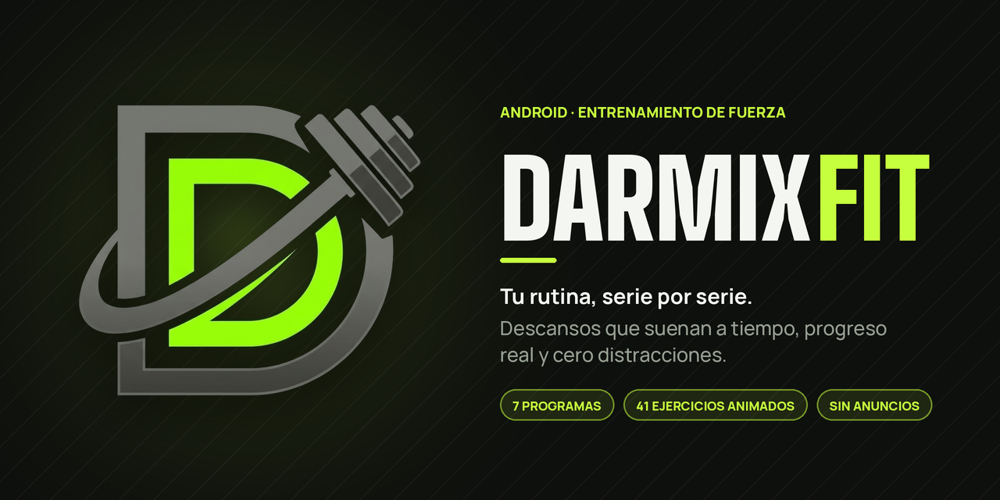

<br />
<br />

<a href="https://github.com/OrlandoGalvanVargas/darmixfit/releases/latest">
  
</a>
&nbsp;
<a href="https://darmixista.dev/darmixfit/">
  
</a>

<br />
<br />

[](https://github.com/OrlandoGalvanVargas/darmixfit/releases/latest)
[](https://github.com/OrlandoGalvanVargas/darmixfit/releases)
[](#-instalación)
[](https://kotlinlang.org)
[](https://developer.android.com/compose)

<br />

**[Características](#-características)** ·
**[Capturas](#-en-acción)** ·
**[Programas](#%EF%B8%8F-programas-incluidos)** ·
**[Instalación](#-instalación)** ·
**[Permisos](#-permisos)** ·
**[Stack](#%EF%B8%8F-stack-técnico)** ·
**[Privacidad](#-privacidad)**

</div>

<br />

## 🏋️ Acerca de DarmixFit

**DarmixFit** es una app de Android para entrenar fuerza **sin perder el hilo**. Abres la app, ves el
ejercicio que toca, completas la serie y el descanso arranca solo. Cuando suena la campana, ya sabes
qué sigue.

Nada de cuentas, anuncios ni pantallas de más: tu plan de la semana, tu progreso de hoy y un
temporizador en el que puedes confiar, **aunque el teléfono esté bloqueado**.

<div align="center">
  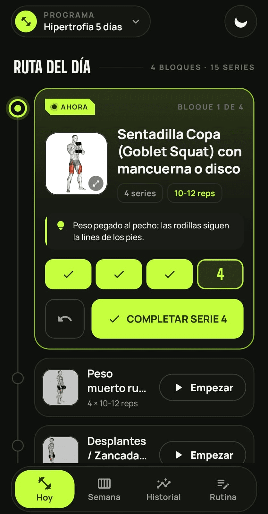
  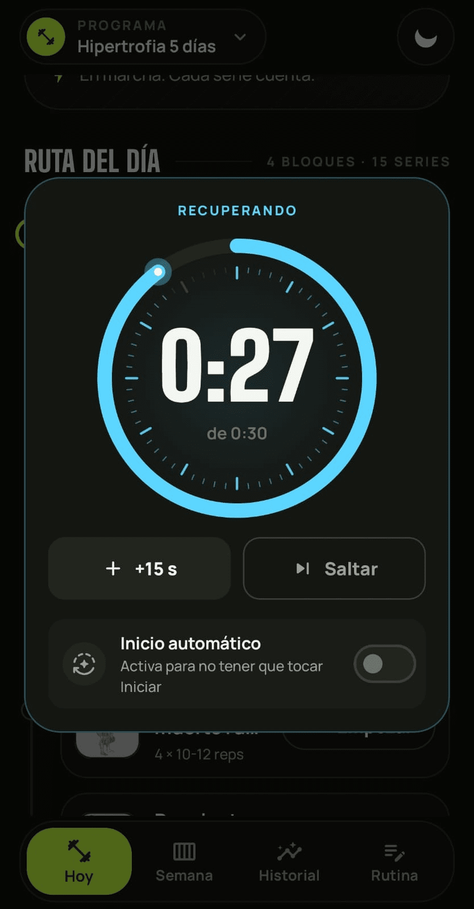
  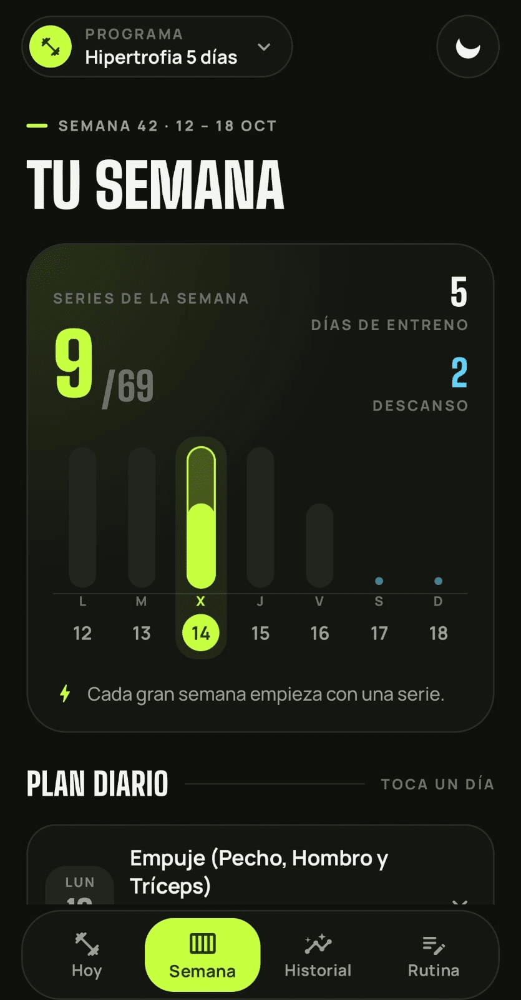
  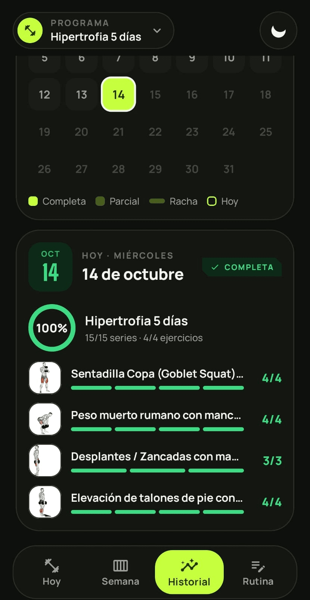
</div>

<br />

## ✨ Características

<table>
<tr>
<td width="50%" valign="top">

### 🧭 Ruta del día
Tu entrenamiento como un recorrido: el ejercicio actual al frente, los terminados se compactan y la
pantalla se desplaza sola al siguiente. Soporta **superseries** y puedes elegir con qué empezar.

</td>
<td width="50%" valign="top">

### ⏱️ Descanso que no falla
Temporizador en primer plano con **alarma exacta de respaldo**. Modo automático: completas la serie y
el descanso arranca solo. **+15 s** o saltar con un toque.

</td>
</tr>
<tr>
<td width="50%" valign="top">

### 🔒 Desde la pantalla de bloqueo
La serie actual aparece en la pantalla de bloqueo. Toca **Completar serie** y el descanso empieza
**sin desbloquear el teléfono**.

</td>
<td width="50%" valign="top">

### 🔔 Una campana propia
El aviso de fin de descanso es un sonido **sintetizado por código**, único de DarmixFit. Si usas
audífonos, suena **solo en ellos**.

</td>
</tr>
<tr>
<td width="50%" valign="top">

### 📅 Semana e historial
Mira de un vistazo qué toca cada día y qué completaste. El historial guarda cada sesión con
sus ejercicios y series.

</td>
<td width="50%" valign="top">

### 🗂️ Programas listos y editables
**7 programas** incluidos, desde 2 hasta 5 días. Cambia de programa cuando quieras o arma el tuyo:
ejercicios, series, repeticiones, notas, orden y superseries.

</td>
</tr>
<tr>
<td width="50%" valign="top">

### 🎞️ Ejercicios animados
**41 ejercicios** con GIF incluido, listos sin descargar nada. También puedes poner tu propia foto o
GIF a cualquier ejercicio.

</td>
<td width="50%" valign="top">

### 🌗 Tema claro y oscuro
Un sistema de diseño propio (tinta, volt y tide) con tipografía **Big Shoulders + Manrope**. Cambia de
tema con un toque.

</td>
</tr>
<tr>
<td width="50%" valign="top">

### 🧩 Configuración guiada
Una pantalla de permisos paso a paso que detecta lo que ya activaste y te dice exactamente qué tocar,
incluso en teléfonos **Xiaomi / HyperOS**.

</td>
<td width="50%" valign="top">

### 🚀 Se actualiza sola
Cuando hay una versión nueva en GitHub, la app te avisa, **descarga el APK** y lo instala con un
toque.

</td>
</tr>
</table>

<br />

## 🎬 En acción

<div align="center">

<table>
<tr>
<td align="center" width="50%">
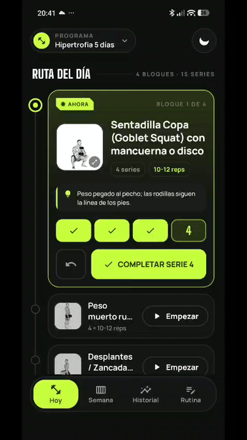<br />
<sub><b>Serie → descanso → siguiente</b></sub>
</td>
<td align="center" width="50%">
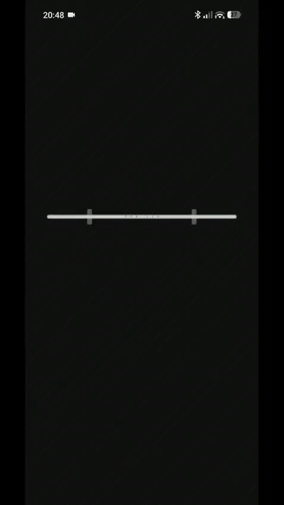<br />
<sub><b>Carga la barra</b></sub>
</td>
</tr>
</table>

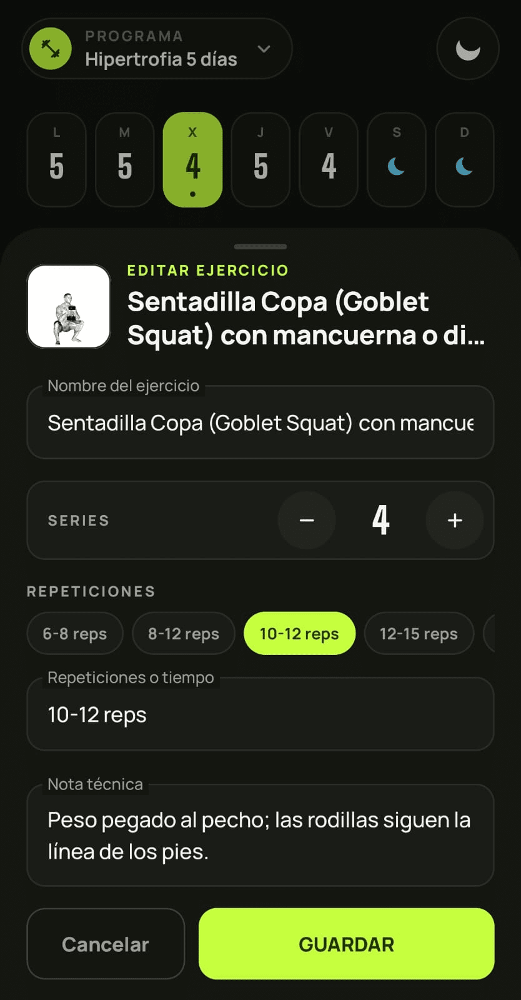
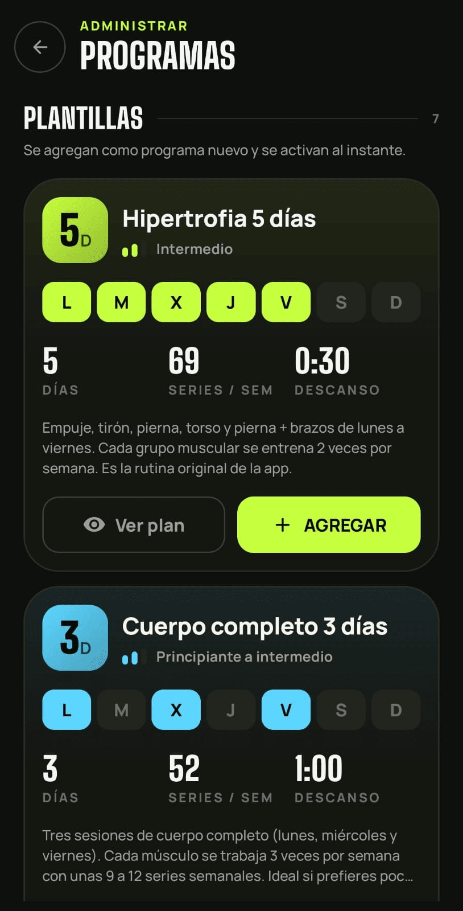
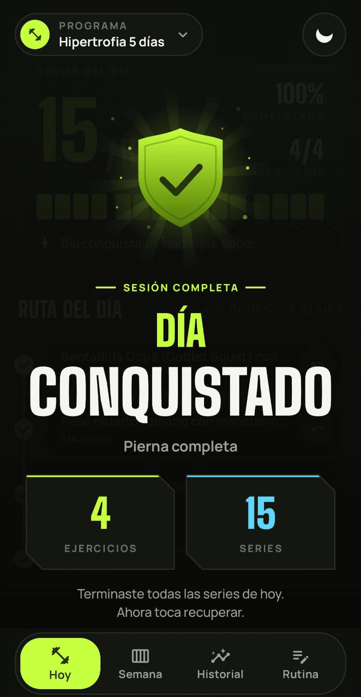
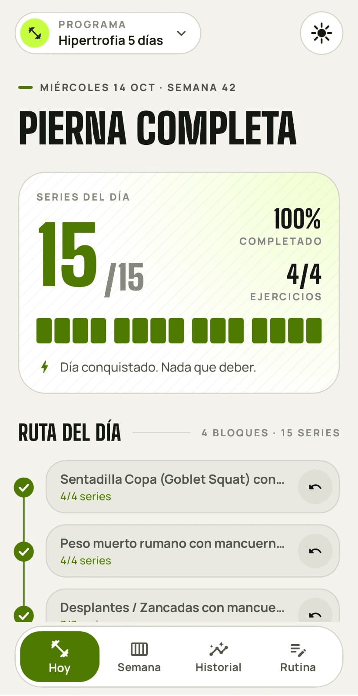

</div>

<br />

## 🗂️ Programas incluidos

| Programa | Días | Nivel | Descanso | Enfoque |
| --- | :---: | --- | :---: | --- |
| **Hipertrofia 5 días** | 5 | Intermedio | 30 s | Empuje, tirón, pierna, torso y pierna + brazos. Cada músculo 2 veces por semana |
| **Cuerpo completo 3 días** | 3 | Principiante a intermedio | 60 s | Lunes, miércoles y viernes de cuerpo completo |
| **Torso / Pierna 4 días** | 4 | Intermedio | 90 s | Dos días de torso y dos de pierna |
| **Fuerza 3 días** | 3 | Intermedio | 150 s | Cargas altas, 5 a 8 repeticiones y descansos largos |
| **Circuitos 4 días** | 4 | Cualquiera | 60 s | Circuitos de 5 ejercicios con descanso al final de cada ronda |
| **Calistenia 4 días** | 4 | Cualquiera | 60 s | Sin mancuernas: peso corporal, una silla y una mesa |
| **Express 2 días** | 2 | Cualquiera | 45 s | Dos sesiones cortas para semanas apretadas |
| **Programa en blanco** | — | — | 30 s | Empieza de cero y arma el tuyo |

> [!TIP]
> Todos los programas se pueden editar. Cambiar de programa **no borra** tu historial.

<br />

## 🚀 Instalación

| Requisito | Valor |
| --- | --- |
| **Android** | 8.0 Oreo (API 26) o superior |
| **Cuenta** | No necesitas ninguna |
| **Internet** | Solo para buscar actualizaciones |

1. Descarga el **APK** desde la [**última versión**](https://github.com/OrlandoGalvanVargas/darmixfit/releases/latest) o desde la [**página oficial**](https://darmixista.dev/darmixfit/).
2. Ábrelo desde tus descargas.
3. Si Android lo pide, **permite instalar apps de esta fuente**.
4. Abre DarmixFit y sigue la configuración guiada (menos de un minuto).
5. Elige tu programa y empieza a entrenar.

> [!IMPORTANT]
> DarmixFit **no está en Google Play**: se distribuye como APK desde este repositorio. Las
> actualizaciones llegan dentro de la app, no hace falta volver a descargarla a mano.

<br />

## 🔐 Permisos

La app te guía en cada uno y **detecta sola** cuáles ya están activos. Todos sirven para lo mismo:
que el descanso suene a tiempo.

<div align="center">
  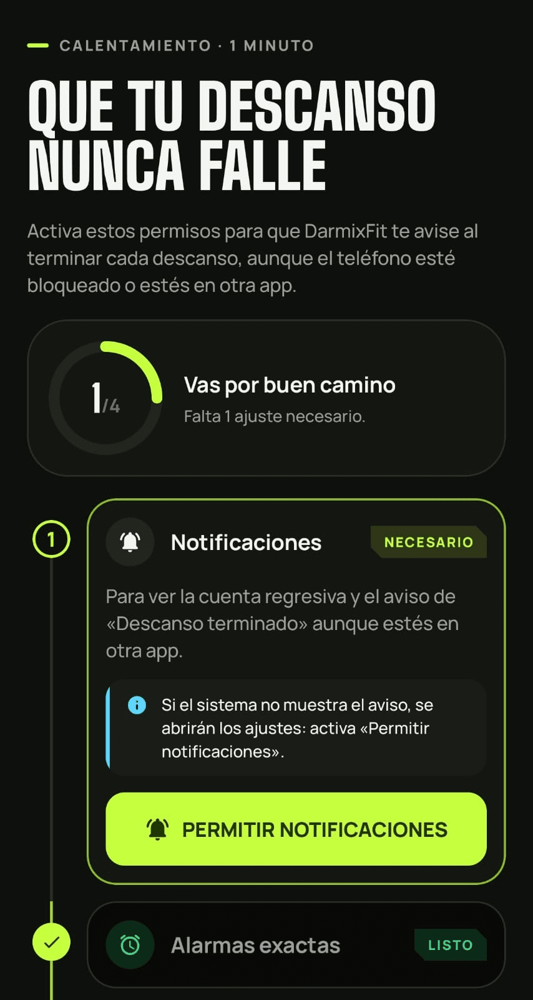
</div>

<br />

| Permiso | Para qué sirve | Tipo |
| --- | --- | :---: |
| 🔔 **Notificaciones** | Cuenta regresiva, aviso de fin de descanso y serie en la pantalla de bloqueo | Necesario |
| ⏰ **Alarmas exactas** | Que el aviso llegue justo en 0:00, incluso con el teléfono en reposo | Necesario |
| 🔋 **Batería sin restricciones** | Evita que Android pause el temporizador para ahorrar energía | Recomendado |
| 🚀 **Inicio automático** | Solo Xiaomi / Redmi / POCO: evita que HyperOS cierre la app | Recomendado |
| 📦 **Instalar apps** | Solo se pide al instalar una actualización | Al actualizar |

<details>
<summary><b>📱 Instrucciones para Xiaomi / HyperOS</b></summary>
<br />

1. En la configuración guiada, toca **Abrir inicio automático**.
2. En la lista, busca **DarmixFit** (puedes usar la lupa de arriba).
3. Activa el interruptor junto a DarmixFit.
4. Regresa a la app: el paso se marca solo.

Extra: en **Recientes**, mantén presionada DarmixFit y toca el **candado** para que el sistema no la
cierre.

</details>

<details>
<summary><b>🔒 ¿No aparece la serie en la pantalla de bloqueo?</b></summary>
<br />

- Revisa que en **Ajustes → Notificaciones → Pantalla de bloqueo** esté permitido mostrar notificaciones.
- La notificación aparece cuando ya completaste al menos una serie del día y sales de la app.
- En algunos teléfonos (por ejemplo, ciertas versiones de MIUI) el sistema pide desbloquear para usar los botones de cualquier notificación.

</details>

<br />

## 🛠️ Stack técnico

<table>
<tr>
<td valign="top" width="50%">

**Lenguaje y UI**

- Kotlin `2.2` · Jetpack Compose (BOM `2026.02`)
- Material 3 con sistema de diseño propio
- Animaciones con Compose Canvas
- Splash animado y edge-to-edge

</td>
<td valign="top" width="50%">

**Arquitectura**

- MVVM: `ViewModel` + `StateFlow`
- Repositorio único sobre Room
- Corrutinas y `Flow` reactivos
- Navigation Compose

</td>
</tr>
<tr>
<td valign="top" width="50%">

**Persistencia y medios**

- Room `2.8` (SQLite) con migraciones
- SharedPreferences para ajustes
- Coil `3` con soporte de GIF animado

</td>
<td valign="top" width="50%">

**Sistema**

- Servicio en primer plano (`specialUse`)
- `AlarmManager` exacto como respaldo
- `AudioTrack` con sonido sintetizado
- `DownloadManager` para actualizaciones

</td>
</tr>
</table>

<details>
<summary><b>🧱 Cómo fluye un descanso</b></summary>
<br />

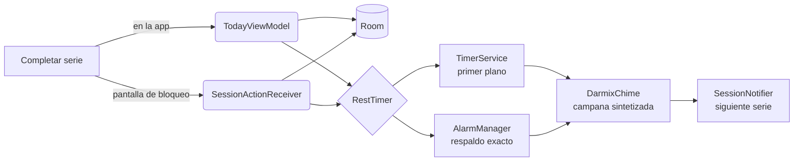

</details>

<details>
<summary><b>📁 Estructura del proyecto</b></summary>
<br />

```
DarmixFit/app/src/main/java/com/darmix/darmixfit/
├── data/          Room, repositorio, catálogo de ejercicios y programas
│   └── update/    Búsqueda e instalación de actualizaciones
├── service/       Temporizador, alarma, campana y notificaciones de sesión
└── ui/
    ├── today/     Ruta del día y celebración
    ├── timer/     Diálogo de descanso
    ├── week/      Vista semanal
    ├── history/   Historial de sesiones
    ├── edit/      Editor de rutina
    ├── programs/  Programas
    ├── permissions/  Configuración guiada
    ├── splash/    Splash animado
    ├── update/    Aviso de actualización
    ├── components/  Componentes del sistema de diseño
    └── theme/     Colores, tipografía, formas y movimiento
```

</details>

<br />

## 🔒 Privacidad

**Tus entrenamientos se quedan en tu teléfono.**

- ✅ Todo se guarda localmente, sin cuentas ni servidores propios
- ✅ Sin anuncios, rastreo ni telemetría
- ✅ La única conexión es a GitHub, para buscar actualizaciones
- ✅ Desinstalar la app borra todos tus datos

<br />

## 🐛 Reportar problemas y sugerencias

¿Algo no funciona o se te ocurre una mejora? Abre un [**issue**](https://github.com/OrlandoGalvanVargas/darmixfit/issues/new) con:

- 📱 Modelo de teléfono y versión de Android
- 🏷️ Versión de DarmixFit
- 📝 Qué pasó y qué esperabas que pasara
- 📸 Captura o video si aplica

<br />

## 📜 Historial de versiones

| Versión | Fecha | Resumen |
| --- | --- | --- |
| **v1.0** | 2026-10-14 | Lanzamiento: ruta del día, descanso automático, serie desde la pantalla de bloqueo, 7 programas, 41 ejercicios animados, historial, tema claro/oscuro y actualizaciones dentro de la app. |

<br />

## 📄 Licencia

DarmixFit es un proyecto de **uso personal**. Todos los derechos reservados © 2026 Darmixista.

Puedes descargar y usar la app libremente. No se permite redistribuirla, modificarla ni usarla con
fines comerciales sin autorización del autor.

<br />

---

<div align="center">


<br />

**Hecho con 💚 por [Darmixista](https://darmixista.dev)**

<sub>Supérate cada día.</sub>

<sub>[Página oficial](https://darmixista.dev/darmixfit/) · [Descargas](https://github.com/OrlandoGalvanVargas/darmixfit/releases) · [Reportar un bug](https://github.com/OrlandoGalvanVargas/darmixfit/issues)</sub>

</div>
